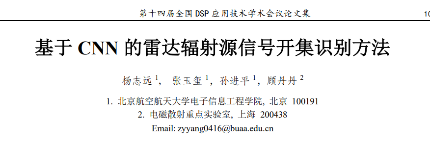
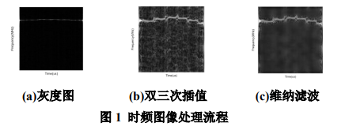
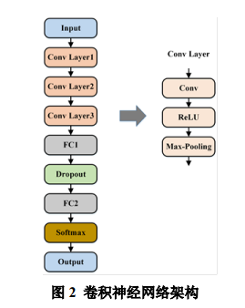
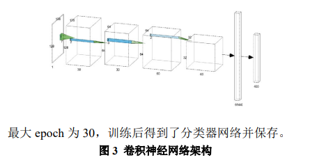
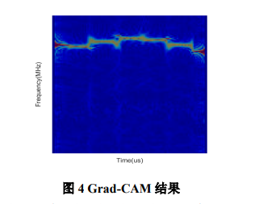
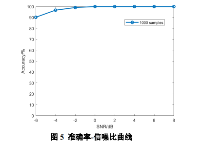
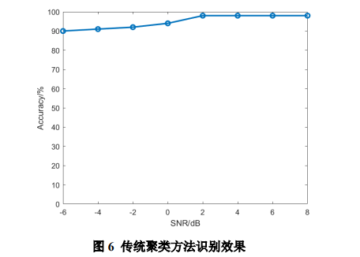
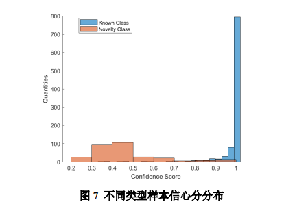
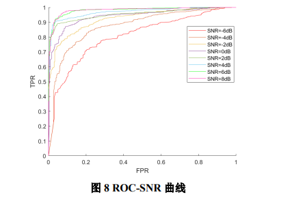
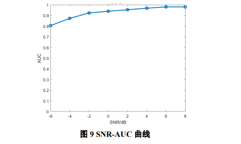

# Radar Signal Selection Based on CNN for Radiation Source Signal Open Set Identification [with MATLAB Code]

Yang Zhiyuan 1, Zhang Yuxi 1, Sun Jinping 1, Gu Dandan 2
1  
School of Electronic Information Engineering, Beijing University of Aeronautics and Astronautics, Beijing 100191. Key Laboratory of Electromagnetic Scattering, Shanghai 200438.
Abstract: Radar radiation source signal recognition is an important component of electronic support measures. With the increasingly complex battlefield electromagnetic environment and the continuous development of modern radar modulation methods, traditional methods for recognizing radar radiation source signals have faced significant challenges. This paper proposes a radar radiation source signal open-set recognition method based on Convolutional Neural Network (CNN). Initially, pseudo Wigner-Ville distribution is employed to extract time-frequency features from radar radiation source signals. Subsequently, the problem of open-set recognition of radar radiation source signals is addressed through a combination of convolutional neural networks and confidence scores. Simulation experiments demonstrate that under a -6dB signal-to-noise ratio, the proposed method achieves a recognition accuracy rate of 90%, effectively addressing the issue of radar radiation source signal recognition.
Keywords Radar radiation source identification; Machine learning; Convolutional neural network; Time-frequency analysis
Open Set Recognition Method of Radar Emitter Signal Based on CNNYANG Zhiyuan1, ZHANG Yuxi1, SUN Jinping1, GU Dandan2  
1  
School of Electronic Information Engineering, Beihang University, Beijing, 100191, China 2. Science and Technology on Electromagnetic Scattering Laboratory, Shanghai, 200438, China  
AbstractRadar Emitter Identification (REI) plays an important role in electronic support measures. However, traditional radar emitter identification methods have met great challenges with the electromagnetism environment becoming more complex and the modulation of radar signals becoming more sophisticated. This paper proposes an open set REI method based on convolutional neural network (CNN). First, the pseudo Wigner-Ville distribution is used to extract the time-frequency features of radar signals, and then CNN and confidence score are used to solve open set REI problem. The simulation results show that the identification accuracy of the proposed method reaches 90% under -6 dB signal-to-noise ratio, which works well.  
Keywords Radar Emitter Identification, machine learning, convolutional neural network, time-frequency analysis
Document Identifier: A
Classification Code: TN95
1 Introduction Radar Emission Source Identification (REI) was first proposed in the 1960s. It refers to the technology of identifying individual radar sources through receiving radar electromagnetic signals and analyzing their individual characteristics to recognize them. Acquiring enemy radar electronic intelligence is a precursor to electronic support measures. If accurate detection of radar information can be achieved, based on its intensity and characteristics, it can reveal the hidden dangers and the next tactical actions to take, as well as conduct electronic attacks against enemy radar. With the continuous development of modern weapons, accumulating relevant radar signal intelligence is of great significance during peacetime.
The early technology for identifying radar radiation sources typically extracted pulse description words (PDWs), which contain five parameters: carrier frequency (RF), pulse width (PW), pulse amplitude (PA), time of arrival (TOA), and direction of arrival (DOA). By comparing the radar description word with a pre-established database of radiation sources, the identification of radar radiation sources can be achieved. However, as radar technology continues to evolve, the diversity of radar signal forms has increased, leading to a decline in the effectiveness of PDW-based methods for identifying radiation sources. Recent research has shifted towards the extraction of intra-pulse features of radar signals.
Machine learning analyzes data to abstract its inherent patterns and applies these patterns for prediction. It has achieved great success in classification problems, with numerous studies in recent years introducing machine learning methods into radar radiation source identification issues. As the amount of data continues to grow, deep learning models based on feedforward neural networks have gradually become a hot topic in machine learning. Literature [4,8,9] extracts different radar signal features and employs neural network architectures as classifiers, efficiently achieving the task of radar radiation source identification, demonstrating the robustness of convolutional neural network models.
To achieve the task of open-set identification of radar signals, this paper proposes a radar radiation source signal recognition method based on convolutional neural networks. Firstly, the pseudo Wigner-Ville distribution (PWVD) is used to extract time-frequency features of radar signals, followed by the classification of time-frequency images through a convolutional neural network, and then open-set identification of signals is conducted using confidence scores. This paper compares the proposed method with the method based on support vector machines for radiation source signal recognition, proving the effectiveness of the method.
2 Based on Convolutional Neural Networks for Radiation Source Signal Recognition
This paper uses PWVD to extract time-frequency features of radar radiation sources, employs bicubic interpolation and Wiener filtering for image denoising, forming a database of radar radiation sources. The recognition of radar radiation sources is realized through training a convolutional neural network model.
Time-frequency analysis is an important method for processing non-stationary signals, which combines the time domain and frequency domain to analyze the signal, overcoming the defects of single analysis in either time domain or frequency domain, and presenting the characteristics of the signal within the time-frequency plane. For signals, its PWVD definition formula is:
where rectangular window function is introduced to effectively suppress cross-term interference.
After obtaining the time-frequency image, further processing is required to form a training set for radar radiation source identification. Firstly, the images need to be converted into grayscale and normalized within the range [0, 225]. Secondly, the size of the original images needs to be adjusted. The bicubic interpolation algorithm is the most commonly used interpolation method in two dimensions, which can better preserve image details than bilinear filtering. Bicubic interpolation can be represented as:
Using bicubic interpolation to uniformly convert the grayscale image to a size of 128×128. Thirdly, denoising processing is performed on the uniformly sized images. Wiener filtering is a common image denoising method based on linear minimum mean square estimation (LMMSE) signal processing. The process of time-frequency image processing is shown in Figure 1.
Convolutional neural networks include two main modules: feature extraction and classification recognition. It maps the distribution of time-frequency features from high dimensions to a lower-dimensional feature space, ultimately achieving the separation of radar radiation source signals.
The convolutional layer of a convolutional neural network typically consists of three stages: the first stage performs convolution operations to extract features from the input, the second stage applies a non-linear activation function to the output of the first stage, and the third stage further adjusts the output of the convolution layer through pooling functions, as shown in Figure 2.
The convolution operation in a convolutional layer can be represented as:
The convolutional kernel slides along the input image in both the vertical and horizontal directions, extracting local features of the image through convolution operations. After convolutional operations, the output often needs to pass through an activation function. The rectified linear unit (ReLU) is an activation function without saturation, represented by:
The gradients of this model are simple 0 or 1, which ensures that the gradients can smoothly propagate backwards, solving the problem of vanishing gradients. At the same time, its convergence speed is much faster than the Sigmoid and Tanh functions, making it widely used in convolutional neural networks. The pooling function uses the overall features of the output at a certain position to replace the network's output at that position. Pooling operations can greatly reduce the amount of data in the feature map, preventing overfitting.
Radar time-frequency images are grayscale images, and the number of types of radar signals in this paper and the size of radar time-frequency images are similar to those in the handwritten digit recognition task. Therefore, this paper adopts the basic convolutional neural network architecture proposed in [10], as shown in Figure 3. The first convolutional block has a size of 7×7, the second convolutional block has a size of 5×5, and the number of neurons is 400. After determining the architecture of the convolutional neural network, it is trained with the Adam optimizer, an initial learning rate of 0.001, a batch size of 64, a maximum number of epochs of 30, and after training, a classifier network is obtained and saved.
In real-world recognition tasks, it is impossible to collect a large amount of all categories training set data. A more common situation is known as open set recognition (OSR).
The problem of radar signal open set recognition can be defined as: Assuming there are M known signal classes in the radar database, each class represented by a vector of dimension d, and each signal type is represented by label y. They form the known signal space, where the number of known type samples is U, and the number of unknown type samples is V. The open set recognition model f should satisfy: For known type samples x, it should satisfy, for unknown type samples, then the open space risk (Open Space Risk) can be defined as
The objective of open set identification is to find a model f that minimizes the open set risk.
The minimum, where the normalization coefficient is involved. The definition of open set risk not only includes the open space risk but also the empirical risk, balancing the performance of model classification and open recognition.
The output layer of the convolutional neural network proposed in this paper employs a Softmax function to transform multi-dimensional vector features into a probability distribution. It is assumed that the convolutional neural network model is trained to distinguish N different types of samples. For each input feature vector x, the output layer's Softmax function will calculate the probability distribution.
Determine the category of the input feature vector. The maximum value in the softmax probability distribution is known as the confidence score, which represents the higher the confidence score, the higher the certainty of classification. Literature [11] points out that for samples with incorrect or unknown types, the confidence score is generally lower and significantly different, thus it can be used as a standard for anomaly detection. This literature regards the confidence score as a criterion for measuring sample ignorance, applying this method to multiple datasets within computer vision, natural language processing, and speech signal processing fields, proving its feasibility. This indicates that although the probability distribution output by the softmax function cannot be directly used for reliability, simple statistical data derived from the softmax function output can provide a benchmark for assessing whether a sample belongs to an unknown type or has been misclassified. Therefore, the confidence score can be considered as a benchmark for open set recognition. This paper adopts the confidence score as a criterion for measuring the degree of unknownness in radar signals, and experiments were conducted on a test set containing unknown types of radar radiation sources using a trained convolutional neural network.
4 Simulation Experiment Results and Analysis
In this paper, we selected 10 different types of radar signal for experimentation, with specific parameters as shown in Table 1. The training set includes signals without frequency modulation (FM), LFM (including both up- and down-frequency modulation), Costas codes, Frank codes, Barker codes, and P1 and P3-P4 codes, which form an open set detection set. The SNR range was from -6dB to +6dB, with each SNR level producing 100 signals per category, totaling 12,000 training samples. A random selection of 30% of these samples were used for validation to determine hyperparameters.
Table 1: Radar Radiation Source Test Signal Parameters
Radar Waveform
Parameter Settings
Single Frequency Signal
BW=0
LFM
BW= (5,100)MHz U
Costas Code
{3,2,6,4,5,1}, {5,4,6,2,3,1}
Barker Code
N=7,11,13
Frank Code
M=4
To observe whether convolutional neural networks can extract effective features from radar radiation source signals, the Grad-CAM method was employed to observe the areas of interest by the CNN. Grad-CAM is a lightweight plugin that does not alter the original network architecture. It calculates the weighted contribution of each channel output feature map to the classification decision and accumulates it, resulting in a heatmap visualization of the impact of each part of the input image on the final decision. As shown in Figure 4, the convolutional neural network focuses more on areas with energy concentration, with less interference from noise, indicating that the architecture effectively extracts time-frequency image features.
The model testing results are shown in Figure 5. When the SNR is above -6dB, the accuracy rate of radar radiation source signal recognition consistently exceeds 90%, proving that the model has good robustness.
The traditional clustering methods extract five parameters of the signal: radio frequency, bandwidth, pulse width, pulse interval, and modulation type. They separately extract 24 feature vectors from the pulse signals to form a 5×24 matrix of received signal characteristics. Support vector machine is used for clustering the signals, and the recognition results are shown in Figure 6.
It can be seen that under the same signal-to-noise ratio, the radar radiation source recognition method based on CNN significantly outperforms the traditional clustering method, proving the effectiveness of this method.
Regenerate test set data for open set recognition, which includes 13 types of signals without modulated frequency, LFM (including up-modulated and down-modulated), Costas code, Frank code, Barker code, P1 code, P2 code, P3 code, P4 code. The signal-to-noise ratio ranges from -20 dB to +20 dB, with 100 signals produced per category at different signal-to-noise ratios. The trained convolutional neural network is used to recognize the signals and calculate confidence scores. The threshold for open set recognition is determined based on the confidence score size.
Figure 7 shows the distribution of confidence scores for known and unknown types of samples. It is evident that the confidence scores for known types of samples are much higher than those for unknown types, indicating a significant difference between the two distributions. Therefore, a threshold can be set to distinguish between them. The receiver operating characteristic curve (ROC) and area under the curve (AUC) are used as indicators to measure the performance of open set recognition. As shown in Figure 8, the area under the ROC curve is greater than 0.5, demonstrating good robustness of the method.
Figure 9 shows the relationship between AUC and signal-to-noise ratio. As the signal-to-noise ratio increases, the AUC gradually approaches 1. When the signal-to-noise ratio is greater than -2 dB, the classification effect of the classifier is very ideal, and this method can effectively complete the open set recognition task.
5 Conclusion This paper proposes a radar radiation source signal recognition method based on convolutional neural network models, and compares it with traditional clustering algorithms. The algorithm proposed in this paper achieves an accuracy rate of 90% under -6dB signal-to-noise ratio. Additionally, through the confidence score method for open set recognition, the AUC is close to 1 under -2dB signal-to-noise ratio, effectively solving the problem of open set recognition for radar signals.
Funding: Supported by the Key Laboratory Fund Project (2021-JCJQ-LB-016-07-01), and the National Natural Science Foundation of China project (61901269).
End

## Images

<!-- PAYMENT_BLOCK -->

## Get this dataset

- Payment link (Stripe): [Buy now](https://buy.stripe.com/3cs8yP7sY87d0vu9AB)
- Payment QR code: 

<!-- /PAYMENT_BLOCK -->
